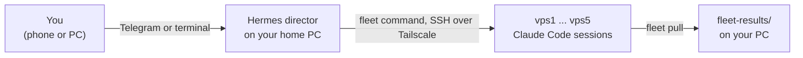

# Hermes Fleet

One [Hermes Agent](https://hermes-agent.nousresearch.com/) on your home PC runs a fleet
of five Hostinger VPSs. Each VPS runs Claude Code sessions that make the videos of its
own channel. You talk to Hermes in the terminal or on Telegram; it queues each video on
its channel's VPS, watches the VPSs, collects the finished videos and tells you what
happened. Hermes runs on a model you choose from another provider, not on Claude.

**Documentation: <https://coffeetimegx.github.io/hermes-fleet/>**



- **5 Claude sessions**, one per VPS, each VPS on its own Hostinger account and Claude
  account. Bigger VPSs can run more sessions at once.
- **Work continues while your PC is off.** Each VPS keeps its own queue and results.
- **Nothing is open to the internet.** SSH reaches the VPSs only over your private
  Tailscale network, and the VPSs cannot reach your PC or each other.
- **One channel per VPS.** Work moves to another VPS only when you say so
  (`fleet handover`).
- **Usage limits are handled.** A VPS that reaches its Claude limit waits for the reset,
  then continues the same session. New jobs for its channel wait there too.
- **Watch it work.** `fleet studio` opens a page that shows every VPS at work, like a
  film lot seen from above.

## Quick start

On Windows, in a normal PowerShell window:

```powershell
irm https://raw.githubusercontent.com/CoffeeTimeGX/hermes-fleet/main/home/install.ps1 | iex
```

On Linux or macOS:

```bash
git clone https://github.com/CoffeeTimeGX/hermes-fleet ~/hermes-fleet
cd ~/hermes-fleet && ./home/install.sh
```

Then follow [Getting started](https://coffeetimegx.github.io/hermes-fleet/getting-started/):
Hermes' model and Telegram, Tailscale, the five VPSs, and a first test job on each.

## What is in the repository

| Folder | What it holds |
| --- | --- |
| `home/` | What runs on your PC: the `fleet` command, the studio page, the installers, Hermes' `SOUL.md` and its two fleet skills, and templates for your settings and secrets. |
| `vps/` | What runs on a VPS: the setup and lockdown scripts, the job worker and the Claude Code provider. `fleet` copies this folder to each VPS. |
| `jobs/examples/` | Example jobs. |
| `docs/` | The documentation site. |
| `tests/` | Unit tests, a local end-to-end test and a full run against a fake VPS. |

Your inventory, secrets and SSH key live on your PC outside the repository, in
`~/.config/fleet/` and `~/.ssh/`. Never commit them.

## Development

```bash
python3 -m unittest discover -s tests -v    # unit tests
bash tests/e2e-local.sh                     # three fake VPSs on this machine
bash tests/vps-container.sh                 # a fake Hostinger VPS in Docker, over real SSH
pip install -r requirements-docs.txt
mkdocs serve                                # preview the docs at http://127.0.0.1:8000
```

See [`AGENTS.md`](AGENTS.md) for the rules every change must keep, and the
[handoff page](https://coffeetimegx.github.io/hermes-fleet/handoff/) for the full
picture.
