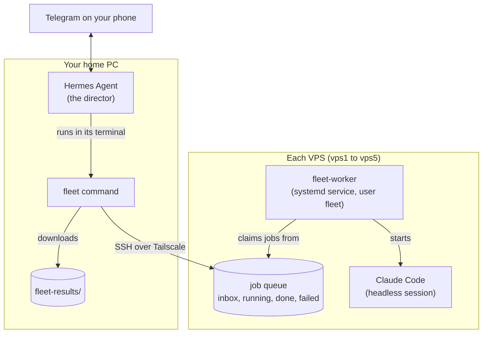
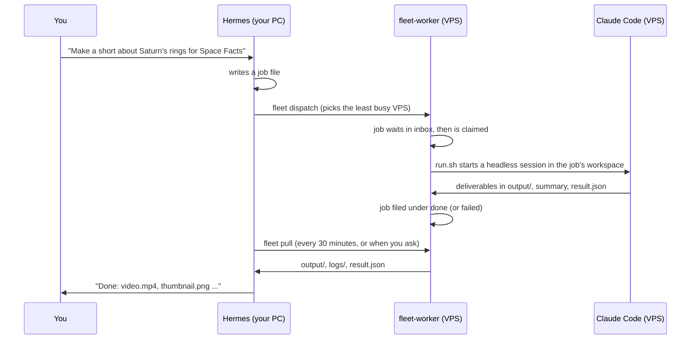

# How it works

## The pieces

**Hermes, the director.** [Hermes Agent](https://hermes-agent.nousresearch.com/) by Nous
Research runs on your home PC. It is the one you talk to. It has a personality file
(`home/hermes/SOUL.md`) that tells it it directs a video fleet, and two skills:
`fleet-ops` for everyday work and `fleet-provision` for setting up and repairing VPSs.
It never renders video itself. It reaches the fleet only through the `fleet` command.

**The `fleet` command.** A single Python file (`home/bin/fleet`, standard library only)
that works on Windows, Linux and macOS. Every action is an SSH command to a VPS. You can
use it by hand too; Hermes uses exactly the same commands. See the
[command reference](reference/cli.md).

**Tailscale.** A private network between your devices. Your PC reaches each VPS by its
name (`vps1` to `vps5`) wherever you are, and the VPSs need no open port on the
internet. See [Tailscale](tailscale.md).

**The VPS worker.** On each VPS, `fleet-worker` is a small bash program that runs as a
systemd service under an unprivileged `fleet` user. It keeps a queue of job files, runs
each job in its own workspace and keeps the results until your PC collects them. See
the [worker reference](reference/worker.md).

**Claude Code.** The worker starts one headless Claude Code session per job
(`claude -p` with streaming JSON output), signed in with that VPS's own Claude account.
Claude Code does the actual work: it writes scripts, runs ffmpeg and ImageMagick, and
puts the deliverables in the job's `output/` folder.

## Why one director and no Hermes on the VPSs

- **One place to talk to.** One Telegram bot, one memory, one set of reports.
- **One place for secrets.** Every credential lives on your PC. A VPS only receives the
  Claude credential it needs, and only through `fleet secrets push`.
- **Simple, replaceable VPSs.** A VPS holds a worker script and Claude Code. If one
  breaks, rebuild it in hPanel and provision it again in about ten minutes.
- **Claude Code is already an agent.** Each session plans and executes its own job.
  A second agent layer on every VPS would add cost and failure points without adding
  ability.

## A job's life

1. **Dispatch.** `fleet dispatch` checks the status of every VPS and picks the least busy
   one that can take the job right now. It uploads the job file into that VPS's
   `jobs/inbox/`. You can also choose a VPS (`--to vps2`) or send a copy to every VPS
   (`--to all`).
2. **Claim.** The worker checks the inbox every 5 seconds. When fewer jobs are running
   than the VPS's `sessions` setting, it claims the oldest job and starts it in its own
   process session, so restarting the worker never kills a running job.
3. **Workspace.** The job gets a folder, `work/<job-id>/`. The worker copies the job's
   template (if it names one) and the job's own files into it.
4. **Session.** The Claude provider runs Claude Code in that folder with the job's
   prompt, limits and settings, and records everything it does in
   `logs/transcript.jsonl`.
5. **Finish.** Claude Code's final answer becomes `output/SUMMARY.txt`. The job is filed
   as `done`, or as `failed` with a reason such as `timed out after 180m`.
6. **Pull.** Your PC downloads `output/`, `logs/`, `result.json`, `status.json` and
   `job.json` into `fleet-results/<vps>/<job-id>/`, then marks the job as pulled.
7. **Clean up.** Each night, a VPS deletes workspaces that were pulled more than 7 days
   ago. Nothing is deleted before your PC has a copy.

## What happens when...

| Situation | What the fleet does |
| --- | --- |
| Your PC is off or asleep | The VPSs keep working through their queues. When the PC is back, the next pull collects everything. |
| A Claude account hits its usage limit | That VPS puts the job back at the front of its queue and starts nothing until the limit resets, then resumes the same Claude session. `fleet dispatch` sends new jobs to the other VPSs. See [Usage limits](operations/usage-limits.md). |
| A VPS reboots or the worker crashes | On restart the worker finds jobs whose process is gone and puts them back in the queue (once, by default), or files them as failed. |
| A job runs too long | It is stopped at its `timeout_minutes` (180 by default) and filed as failed. |
| The disk gets low (under 3 GB free) | The VPS stops starting new jobs; running jobs continue. `fleet health` tells you. See [Disk full](runbooks/disk-full.md). |
| A VPS is unreachable | `fleet health` reports it, and `fleet dispatch` skips it. See [VPS unreachable](runbooks/vps-unreachable.md). |

## Security in one paragraph

Your PC holds every secret. Each VPS has an unprivileged `fleet` user that runs the
worker and Claude Code; it may start, stop and restart its own service, and do nothing
else as root. SSH accepts keys only, and after lockdown it is closed on the public
address entirely, so a VPS is reachable only from your own Tailscale devices. The
Tailscale policy also stops the VPSs from reaching your PC or each other. Details:
[Security](reference/security.md).
