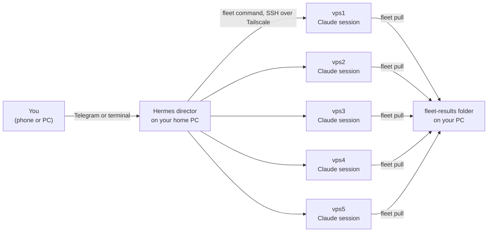

# Hermes Fleet

One [Hermes Agent](https://hermes-agent.nousresearch.com/) on your home computer runs a
fleet of five Hostinger VPSs. Each VPS runs Claude Code sessions that make the videos
of its own channel. You talk to Hermes from the terminal or from Telegram on your
phone. Hermes queues each video on its channel's VPS, watches the VPSs, collects the
finished videos and tells you what happened.

## The fleet at a glance

- **5 Claude sessions**, one on each VPS. Each VPS lives on its own Hostinger account
  and signs in to its own Claude account. A bigger VPS can run more than one session
  at a time.
- **One director.** Hermes runs only on your home computer, on a model you choose from
  another provider: it does not use Claude. The VPSs run a small job worker and Claude
  Code, nothing else, so a VPS can be rebuilt in a few minutes.
- **One channel per VPS.** Each VPS makes the videos of the channel your inventory gives
  it. Work moves to another VPS only when you say so.
- **Work continues while your PC is off.** Each VPS keeps its own queue. When your PC
  comes back, Hermes collects whatever finished in the meantime.
- **Nothing is open to the internet.** Once a VPS is set up, SSH is closed on its public
  address and only your own devices reach it, through your private Tailscale network.
- **Usage limits are handled.** When a Claude account reaches its 5-hour or weekly
  limit, that VPS waits for the reset and then continues the same Claude session.
  New jobs for its channel wait there too, unless you move them.
- **Watch it work.** `fleet studio` opens a page that shows the whole fleet like a film
  lot seen from above: every VPS is a sound stage, with what its Claude session is
  doing right now. See [The studio](operations/studio.md).

## Where to start

- **[Getting started](getting-started.md)**: the whole path, from an empty PC to the
  first finished video, in order.
- **[How it works](architecture.md)**: the pieces and what happens to a job.
- **[Everyday use](operations/everyday.md)**: what to ask Hermes, and the `fleet`
  commands behind it.
- **[Runbooks](runbooks/index.md)**: what to do when something goes wrong.

## What is in the repository

| Folder | What it holds |
| --- | --- |
| `home/` | Everything that runs on your PC: the `fleet` command, the studio page, the installers for Windows and for Linux or macOS, Hermes' personality (`SOUL.md`) and its two fleet skills, and templates for your settings and secrets. |
| `vps/` | Everything that runs on a VPS: the first-time setup script, the lockdown script, the job worker and the Claude Code provider. The `fleet` command copies this folder to each VPS. |
| `jobs/examples/` | Sample job files. |
| `docs/` | This site. |
| `tests/` | Automated tests, including a full run against a fake VPS. |

The skills and `CLAUDE.md` files that teach each Claude session how to make videos for
a given channel are a separate step. They plug in as [job templates](operations/job-format.md#templates).
