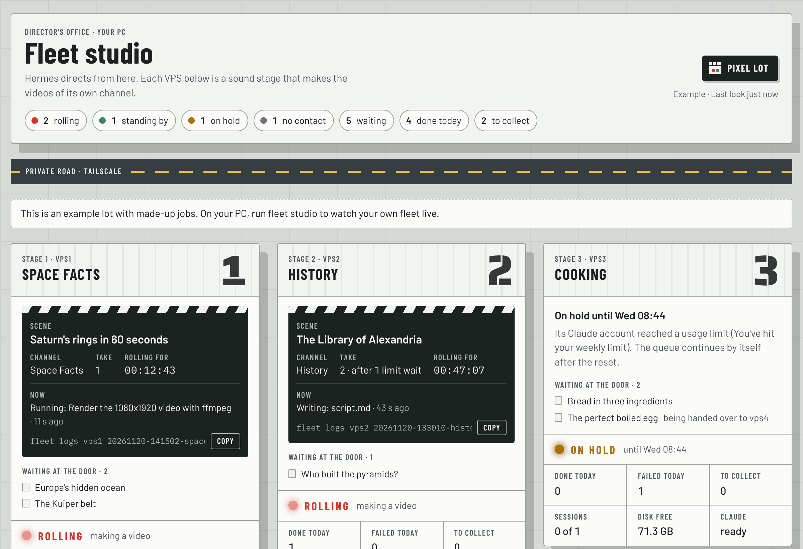
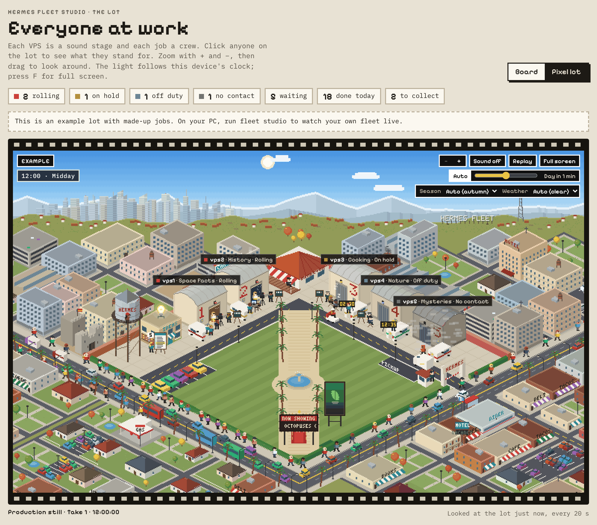
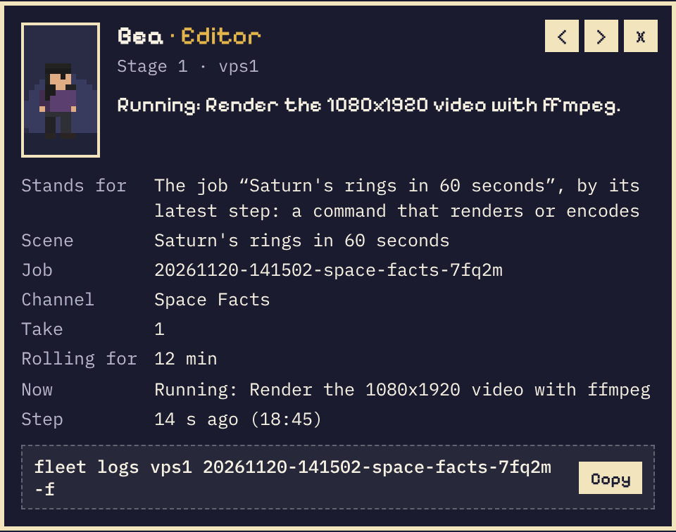
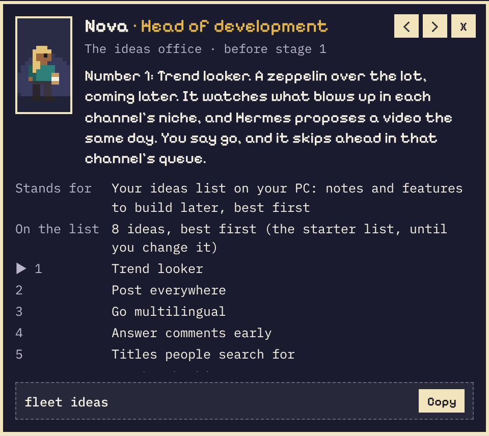
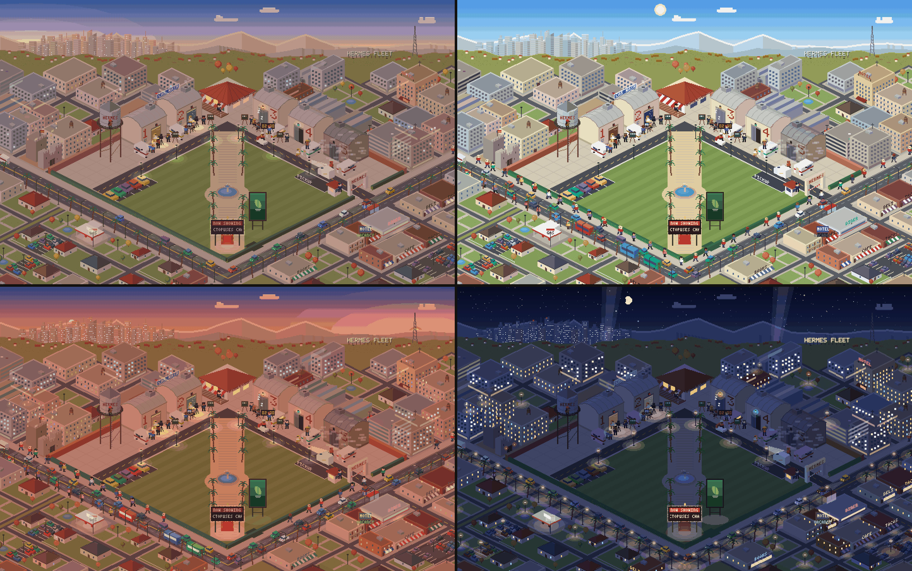
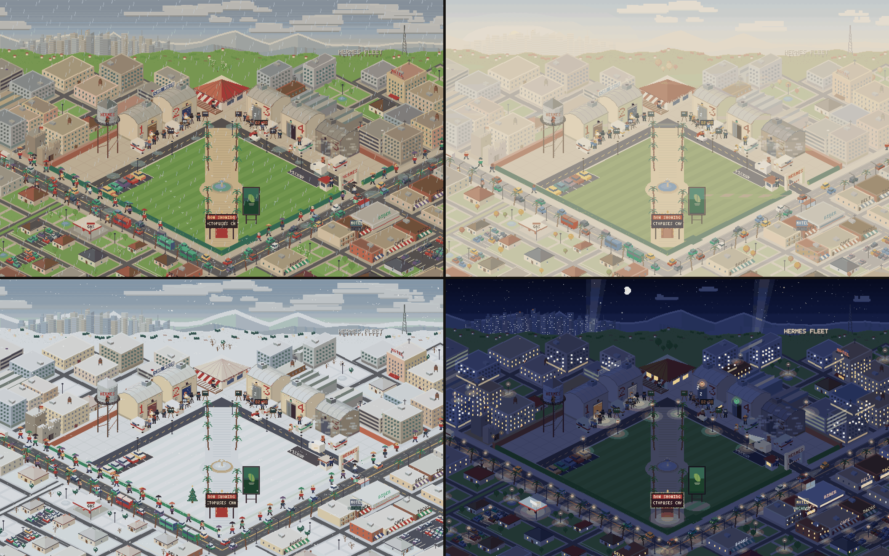

# The studio

The studio is a page in your browser that shows the whole fleet at a glance, like a film
lot seen from above. Your PC is the director's office at the top, the private road is
Tailscale, and every VPS is a sound stage with its channel's name on the roof. You see
which VPSs are making a video, what each Claude session is doing right now, what waits,
and what finished today.

It has two views of the same fleet, with a link at the top of each to the other:

- **Board**: the fleet as signs, slates and tables, for the facts at a glance.
- **Pixel lot**: the fleet drawn as a pixel-art film lot, where everyone at work stands
  for something real. Click anyone to see the real values behind them.

Both views have a screening room, where you watch the videos you have collected, and
can play back the last 24 hours.



It only watches. Nothing on either view changes the fleet: to act, ask the director or
use the `fleet` commands.

## Open it

In a terminal on your PC (PowerShell on Windows):

```
fleet studio
```

```
Fleet studio: http://127.0.0.1:8740/  (pixel lot: http://127.0.0.1:8740/pixel.html)
It looks at the VPSs every 20 seconds and only watches: it changes nothing.
Press Ctrl+C to stop it.
```

Your browser opens the board. Leave the terminal window open: the studio runs as long as
it does, and the page updates by itself. To stop it, press Ctrl+C in that window, or
close it. The VPSs keep working either way.

The director does not open the studio for you, because it keeps running until you stop
it. Ask the director for a status instead when you are away from your PC, or open the
studio on your phone as described below.

## The board

**The office** at the top counts the stages by lamp, the jobs that wait, the jobs that
finished today and the jobs that wait to be collected. It also says when the studio last
looked at the VPSs.

**Each stage** is one VPS:

- The **roof** carries the stage number and the channels the VPS makes.
- A **slate** for each running job: its title (or id), its channel, the take (the
  attempt, with the usage-limit waits it went through) and how long it has been rolling.
  Under **Now** is the session's latest step, such as *Running: Render the video* or a
  line of what it just wrote, and how long ago that was. The `fleet logs` command
  under it follows that job in a terminal; **Copy** puts it on your clipboard.
- **Waiting at the door**: the jobs queued on this VPS.
- The **lamp** over the door, and the **meters**: jobs done and failed today, finished
  jobs not collected yet, sessions in use, free disk, and whether Claude is ready.

| Lamp | Sign | It means |
| --- | --- | --- |
| Red | **Rolling** | A Claude session is making a video. |
| Green | **Standing by** | Ready. The next job for its channel starts at once. |
| Amber | **On hold** | Its Claude account reached a usage limit. The queue continues by itself after the reset, at the time shown. See [Usage limits](usage-limits.md). |
| Blue ring | **Off duty** | Outside its [work schedule](schedule.md). The stage says when it starts again. Running jobs finish first. |
| Off | **Dark** | The VPS is paused. `fleet resume` starts it again. |
| Off | **No contact** | Your PC cannot reach the VPS. See [VPS unreachable](../runbooks/vps-unreachable.md). |
| Yellow and black tape | **Needs a look** | Something needs a fix: the worker stopped, Claude is not ready, or the disk is low. The stage says what. Ask the director, or run `fleet health`. |

**The call board** at the bottom lists every job on the lot: what runs now, what waits,
and what finished in the last 24 hours, with the reason a job waits or failed and
whether a finished job was collected. Times are in the local time of the device you
watch on.

**The last 24 hours**, under the office, has a row for each VPS with its takes of the
last day. The key under it says which colour is which. Click or drag along the strip to
see the board as it stood at that moment: a banner at the top says when, and **Back to
live** returns to now. **Play** runs the day from 24 hours ago, an hour every four
seconds.

**The screening room**, under the stages, shows the videos you have collected with
`fleet pull`, newest first, each with a frame from the video. Click one to watch it in
the page. Esc or **Close** stops it.

## The pixel lot

Click **Pixel lot** at the top of the board. You see the same fleet as a still from a
video game: a film lot in pixel art, seen from above at an angle. People walk, the van
drives its rounds and the lamps blink, all following what the VPSs do.

The lot sits in a small town: mountains and a downtown skyline far off, hills with the
HERMES FLEET sign, blocks of offices, flats and warehouses behind the walls, a boulevard
along the front, and shops, houses and a diner beyond it. The town stands for nothing.
Its cars and passers-by follow the time of day, with more of them at rush hour. Only the
lot and the people on it stand for your fleet.



Everyone on the lot stands for something real:

- Point at someone to see who they are.
- Click or tap them to open their card: what they stand for, what they say, the real
  values behind them, and the `fleet` command that goes with them. **Copy** puts the
  command on your clipboard.
- The **<** and **>** buttons on the card step through everyone on the lot. Esc closes
  the card.
- The **call sheet** under the picture lists everyone, stage by stage. Pick a name there
  to find that person in the picture. It works with the keyboard and a screen reader too.

{ width="480" }

**Board** at the top takes you back.

### Who is who

Around the lot:

| Who | Where | Stands for | On the card |
| --- | --- | --- | --- |
| Hermes, the director | On the porch of the bungalow | Your PC, where Hermes directs the fleet and the studio runs. | The fleet totals, `fleet status` |
| Iris, the lookout | On the water tower | The studio's regular look at the VPSs: one short SSH round each time. | When she last looked, who answered, `fleet ping` |
| Sam, the gate guard | At the front gate | The private road to the VPSs: your Tailscale network. | Which VPSs your PC cannot reach |
| Rio, the courier | At the pickup bay, or driving the van | Finished videos that wait to be collected on your PC. The van stops at each stage that has some. | How many wait on each VPS, `fleet pull` |
| The marquee | By the red carpet | The newest video finished in the last 24 hours. | Its title, its VPS, and the counts for today |
| The screen | On the lawn, by the marquee | The videos you have collected with `fleet pull`. It shows the newest of each channel in turn. | The video on the screen, its channel and VPS, and **Watch** |
| Nova, the head of development | At the easel by the ideas office, before stage 1 | Your ideas list: notes and features to build into the fleet later, best first. | Every idea in order, the one being read out marked, `fleet ideas` |

On each stage:

| Who | Stands for | On the card |
| --- | --- | --- |
| The sound stage, with its number on the front | One VPS and its channels. Its lamp works like the lamp on the board. | Its lamp, sessions, disk, load and memory, `fleet status vps1` |
| The air handler on the roof | How hard the VPS works. The busier it is, the more steam. | Load, memory and disk |
| The stage manager, with a headset | The worker on the VPS that starts each job. | The worker, its heartbeat and the queue, `fleet status vps1` |
| The crew on set | A running job, one person each. Their trade follows the session's latest step (see the next table). | The job, its take, its latest step, `fleet logs vps1 <job-id> -f` |
| Claude, the star | Claude Code on the VPS, signed in with that VPS's own account. On set while a job rolls, in the chair when ready, in the trailer (sign on the door) during a usage limit, a pause or off duty. | Version, how it signed in, whether it is ready, the usage limit |
| Production assistants in line outside | The jobs in the queue, one each. After five, a bubble shows how many more. | The job, its place in line, why it waits, `fleet jobs vps1 --state inbox` |
| A cart driver | A job you asked to move to another VPS. The cart drives it over. | From where to where, `fleet jobs vps1 --state outgoing` |
| The gaffer and the grip, asleep, and the reset clock | A usage limit. The clock shows when it resets. | The limit, since when, and when it resets |
| The night janitor | A paused VPS. | Why it was paused, `fleet resume vps1` |
| The night watchman, on a chair by the door, and the back-at sign | A VPS outside its work schedule. The sign shows when the stage opens again. | Why it is off duty, until when, `fleet schedule show vps1` |
| The electrician, in a hard hat | Something that needs a fix: the worker, Claude not ready, low disk, a reboot for updates, or a stuck handover. | The problem, and `fleet health` or `fleet reboot vps1` |
| The search party, with a flashlight | A VPS your PC cannot reach. | The error, `fleet ping vps1` |
| Film cans in front of the stage | Finished videos on the VPS that are not on your PC yet. | How many, `fleet pull vps1` |
| The dailies board | The videos the VPS finished or failed in the last 24 hours. | The titles, and why a job failed |

The crew's trade shows what the session does right now:

| Crew member | The session's latest step |
| --- | --- |
| Camera operator | It has not taken its first step yet. |
| Director of photography | It said something. The card quotes it. |
| Editor | It runs a command that renders or encodes, such as `ffmpeg`. |
| Technician | It runs another command. |
| Screenwriter | It writes or edits a file. |
| Script supervisor | It reads or searches files. |
| Researcher | It searches the web or reads a web page. |
| Assistant director | It updates its plan. |
| Second unit | It hands a part of the work to a helper. |

### The ideas office

The yellow building with a light bulb on its roof, just before stage 1, holds your ideas
list. Click it, and Nova reads the list out from the top, one idea at a time: the card
types each one, the easel marks its line, and the bulb flashes. A note is pinned on the
side of the office for each idea.

{ width="480" }

To add an idea, tell Hermes on Telegram, for example *"Idea: a weekly summary on Sunday
evenings"*, or run `fleet ideas add`. Until you change the list, it holds the starter
ideas, with the trend looker first. See [`fleet ideas`](../reference/cli.md#fleet-ideas).

### All day and all night

The light on the lot follows the clock of the device you watch on, minute by minute. The
sun and the moon cross the sky, and the moon shows its real phase. At dusk the windows,
street lamps and signs come on one by one. Late at night most windows go dark again, and
at dawn the lamps go out. In the evening, searchlights sweep the sky.



The clock at the top left of the picture shows the time on the lot. The controls are at
the top right, or under the picture on a phone:

| Control | What it does |
| --- | --- |
| **Auto** | The light follows your device's clock. This is how the lot starts. |
| The slider | Holds the lot at the time of day you pick. A phone does not show it. |
| **Day in 1 min** | Runs a whole day in one minute, and keeps going. Click it again to stop. |

Your browser remembers **Auto** or the time you picked.

If your device is set to reduce motion, nobody walks and nothing blinks. The light still
follows the clock, and the picture still follows the fleet.

### Seasons and weather

The lot follows the season of your device's date: blossom and flowers in spring, green
trees in summer, orange leaves in autumn and bare trees in winter. From 1 December to
6 January, lights hang on the lot and a tree stands on the lawn.

The weather is made up from the date and the hour, so every screen shows the same sky.
Most days are fair. Some are grey or wet, some mornings start in fog, and a winter day can
bring snow that stays all day. Like the town, the weather stands for nothing.



To look at another season or another weather, pick it under **Season** and **Weather** at
the top right of the picture. **Auto** goes back to your device's date. Your browser
remembers what you picked.

### Sound

The lot is quiet until you click **Sound off** at the top right of the picture. It then
says **Sound on**, and you hear the town: traffic as busy as the roads, birds by day,
crickets on warm nights, the rain and the wind. You also hear the fleet, from the side of
the lot where it happens:

| You hear | It means |
| --- | --- |
| A clapperboard | A job started rolling. |
| Applause | A video is done. |
| A low horn | A job failed. |
| A falling note | A VPS reached its usage limit. |

Your browser remembers the choice. Browsers play sound only after you click, tap or press
a key on the page, so a lot left with sound on stays quiet until you do. The sound stops
while the tab is hidden. All of it is made in the page as it plays: there are no sound
files.

### The screening room

The screen on the lawn shows the newest video of each channel in turn, nine seconds each,
with a frame from the video. After dark it glows. Click the screen, then **Watch**, to
play the video over the page. Esc or **Close** stops it.

Until `fleet pull` has collected a video, the screen shows colour bars. The example lot
shows title cards instead, and has no videos to play.

### Replay the last 24 hours

Click **Replay** at the top right of the picture, or press R. The lot turns sepia and
plays back the last 24 hours, an hour every four seconds, in the light and the weather of
each moment. The sounds play as they would have live.

A strip at the bottom shows each VPS's takes. Click or drag along it to hold the lot at a
moment, or use the arrow keys on it: an hour with Shift. **Pause** stops the playback,
**Back to live** returns to now, and **Replay** or R again closes the strip.

The replay is rebuilt from the times on the jobs: when each started, finished, failed or
waited for a usage limit. It does not show each step a session took.

### Full screen

Click **Full screen** at the top right of the picture, or press F. The lot fills the
screen. After three seconds without the mouse, the controls on the right fade; move the
mouse to bring them back. To leave, click **Exit full screen**, or press F or Esc.

While the lot fills the screen, your PC's screen stays on, so you can leave the lot open
on a spare screen day and night. Browsers allow that only on your PC's own address
(`127.0.0.1`). On a phone opened with `--tailnet`, set the phone's screen to stay on
yourself. Turn the phone sideways for a bigger lot.

### Zoom in

To look closer, click **+** at the top right of the picture, or hold Ctrl and turn the
mouse wheel over the picture. A touchpad pinch works too, and in full screen the mouse
wheel zooms on its own. On a phone, pinch the picture with two fingers. The pixels stay
sharp at every step, up to six times the whole view.

Zoomed in, drag the picture to look around. **−** zooms out, and **See all** shows the
whole picture again. The keys + and - zoom too, and 0 shows the whole picture. When you
pick a name on the call sheet, the picture moves to show that person.

## Watch from your phone

Start the studio on your PC's Tailscale address instead:

```
fleet studio --tailnet
```

```
Fleet studio: http://my-pc.tailnet-name.ts.net:8740/  (pixel lot: http://my-pc.tailnet-name.ts.net:8740/pixel.html)
It looks at the VPSs every 20 seconds and only watches: it changes nothing.
Press Ctrl+C to stop it.
```

Open that address on your phone, with the Tailscale app connected. It works on your other
devices on your tailnet too. With the fleet's
[Tailscale policy](../tailscale.md), only your own devices can open it.

The first time, Windows may ask whether Python may communicate on networks. Allow it on
private networks: Tailscale marks its own network as private on Windows. If you
declined, open **Windows Security**, then **Firewall & network protection**, then
**Allow an app through firewall**, and tick **Private** for Python. On a Mac with the
firewall on, allow Python to accept incoming connections when macOS asks.

Your PC must be on and the studio running for the phone to see it. The page says
*Lost contact* when the studio stops.

## Options

| Option | Meaning |
| --- | --- |
| `--tailnet` | Open it on your PC's Tailscale address, for your phone and your other devices. |
| `--port PORT` | Another port, when something else uses 8740: `fleet studio --port 8750`. |
| `--every SECONDS` | How often it looks at the VPSs. Default 20, at least 5. |
| `--no-browser` | Do not open the browser. |
| `--json` | Look once, print what it saw as JSON, and exit. |

## How it works

`fleet studio` runs a small web server on your PC, the same way the other `fleet`
commands run: nothing is installed and nothing runs on the VPSs. Every 20 seconds it
makes one short SSH connection to each VPS, like `fleet status`, and asks for the
worker's status, the job list and the last step of each running session (from the end
of its `logs/transcript.jsonl`). Both views ask your PC for that every few seconds.

- Without `--tailnet`, only your PC can open the page (`127.0.0.1`). With it, only
  devices on your tailnet can.
- The server answers only requests addressed to your PC by its own name or address, so
  a web page from somewhere else cannot read the studio through your browser.
- The page loads its fonts from Google Fonts; everything else comes from your PC.
- The screening room plays the files in your results folder (`results_dir` in
  `fleet.ini`) straight from your PC: only what finished jobs left in their `output`
  folder, and only videos and pictures (MP4, MOV, WebM, PNG, JPEG, WebP, GIF). Nothing
  is uploaded anywhere. MP4 videos play in every common browser.

To see the studio without a fleet, open `home/studio/studio.html` (the board) or
`home/studio/pixel.html` (the pixel lot) from the repository in your browser. They show
an example lot with made-up jobs.

## If something looks wrong

| You see | Do this |
| --- | --- |
| A stage says **No contact** | Your PC cannot reach that VPS: [VPS unreachable](../runbooks/vps-unreachable.md). |
| *worker returned no status (run fleet sync)* | The worker on that VPS is missing or did not answer: run `fleet sync`. A VPS that was never set up needs [Provision a VPS](../vps/provisioning.md) first. |
| `cannot open the studio on 127.0.0.1:8740` | Another program uses the port: `fleet studio --port 8750`. |
| *Lost contact with fleet studio on your PC* | The studio stopped. Run `fleet studio` again. |
| The screen shows colour bars, or the screening room says *No videos yet* | Nothing is collected yet: run `fleet pull`. |
| *This job left no video file that the studio can play* | The job's `output` folder holds no MP4, MOV or WebM file. Look in your results folder, or at the job with `fleet logs vps1 <job-id>`. |
| A video does not play | Your browser cannot play that format. Open the file from your results folder instead. |
| You hear nothing with **Sound on** | Click or tap the page once. Check that the browser tab and your device are not muted. |
| `Tailscale is not connected on this computer` | Open Tailscale on your PC and sign in, then run `fleet studio --tailnet` again. |
