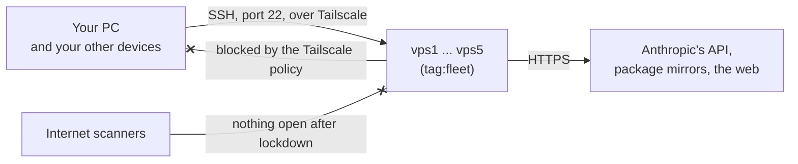

# Security

The fleet is built so that the most valuable things, your secrets and your PC, are
never exposed to the VPSs, and the VPSs are never exposed to the internet. This page
says what protects what, and where the limits are.

## The short version

- **Secrets stay on your PC.** A VPS receives exactly one secret: its own Claude
  credential.
- **The VPSs are closed to the internet.** After lockdown, SSH answers only over your
  private Tailscale network, and only your own devices may use it.
- **The VPSs cannot reach your PC or each other.** Connections always start at your PC.
- **The sessions run without root.** Claude Code runs as the unprivileged `fleet` user,
  which may not change the system.
- **A broken or compromised VPS is replaced, not repaired.** It holds nothing that cannot
  be recreated in about fifteen minutes.

## Where every secret lives

| Secret | Where | What it opens |
| --- | --- | --- |
| Claude token or API key, one per VPS | Your PC (`~/.config/fleet/secrets/<vps>/claude.env`) and that VPS (`~/.config/fleet/providers/claude.env`, readable only by `fleet`) | That VPS's Claude account |
| Hermes' API key | Hermes' `.env` on your PC | The Claude Console account Hermes runs on |
| Telegram bot token | Hermes' `.env` | Your bot |
| Hostinger API tokens (optional) | Hermes' `.env` | Everything in that Hostinger account |
| Tailscale auth key | Your PC (`~/.config/fleet/secrets/tailscale.env`) | Adding machines to your tailnet as `tag:fleet` |
| The fleet SSH key | Your PC (`~/.ssh/fleet_ed25519`) | The `fleet` and `root` users on every VPS |

None of them is in the repository, and none passes through a chat: you type them into
these files yourself, and Hermes is told never to print them or ask for them. How to
change each one: [Rotate credentials](../runbooks/rotate-credentials.md).

## The network

- **Tailscale's access policy** ([`home/tailscale-policy.example.hujson`](https://github.com/CoffeeTimeGX/hermes-fleet/blob/main/home/tailscale-policy.example.hujson))
  lets your own devices reach each other and port 22 on the VPSs. It gives the VPSs,
  tagged `tag:fleet`, no access to anything on your tailnet.
- **The VPS firewall** (ufw) blocks every incoming connection except from Tailscale, and
  UDP port 41641, which Tailscale uses for direct connections. Before lockdown it also
  allows SSH on the public address, rate limited.
- **SSH** accepts keys only, no passwords. Root may log in with a key only. Only the
  `root` and `fleet` users may log in at all. fail2ban bans an address for an hour after
  five failed logins.
- **Outgoing traffic is open.** The sessions need Anthropic's API, and they download
  tools, fonts and footage as they work. The fleet does not restrict where a VPS
  connects to.

## On each VPS

- **The `fleet` user** runs the worker and every Claude session. It has no password. With
  `sudo` it may only start, stop, restart and query its own worker service.
- **Root** is reached only with the fleet key, and only for setup and repairs: the
  bootstrap, lockdown, reboots and `fleet exec --root`. Hermes asks before it uses it.
- **Security updates** install automatically every day. `fleet health` tells you when
  one needs a reboot.
- **The worker service** runs with `NoNewPrivileges` and a read-only view of the system
  folders.

## The Claude sessions

By default a session runs with `bypassPermissions`: it can run any command the `fleet`
user may run, without asking. That is what lets it work unattended, and it means:

- it can read and change every workspace on its VPS, not just its own,
- it can read its VPS's Claude credential,
- it can reach anything on the internet.

Anthropic recommends this mode only for isolated environments. The fleet's VPSs are
isolated in the ways that matter here: each is a machine of its own that does only this
work, holds no other secret, and cannot reach your PC or the other VPSs. They are not
cut off from the internet, because the sessions need it.

The realistic risk is **prompt injection**: a web page, file or video description that a
session reads could contain instructions that trick it, for example into sending its
credential somewhere or deleting work on its VPS. The damage stays on that VPS and that
Claude account, and you can rebuild the one and rotate the other. To lower the risk for
jobs that read content you do not trust:

- give them an exact list of tools with `"permission_mode": "dontAsk"` and
  `allowed_tools` (see [Job format](../operations/job-format.md#permissions)),
- keep web research and production in separate jobs,
- prefer API keys with a spend limit for that kind of work.

**What comes back to your PC** is files made by an unattended session. Open videos and
images as usual. Treat scripts or programs in a job's `output/` like any code you
downloaded: read them before you run them.

## On your PC

Your PC holds every secret, and the fleet key has no passphrase so that the scheduled
checks can use it. Protect the PC accordingly:

- a password or PIN on your user account, and a screen lock,
- disk encryption (BitLocker on Windows, FileVault on macOS, LUKS on Linux),
- updates for the system, Tailscale and Hermes.

Hermes runs commands in your user account. Its guardrails are its instructions
(`SOUL.md` and the skills), the approvals it asks for before risky steps, and a deny list
that `fleet init` sets: no `fleet exec all ... rm -rf`, no reading the secrets folder or
its own `.env`. Telegram reaches Hermes only from the user ids in
`TELEGRAM_ALLOWED_USERS`. These are guardrails, not a sandbox, so keep the bot to
yourself.

## The repository is public

It contains no secrets, addresses or personal details: your inventory, secrets and keys
live outside it, and `.gitignore` refuses the usual secret file names (`*.env`,
`fleet.ini`, `secrets/`, SSH keys). The example files hold empty values only. If a secret
is ever committed by mistake, change it at once: removing it from the history does not
undo the leak.

## If something is compromised

| What | Do this |
| --- | --- |
| A VPS behaves strangely, or may have been broken into | [Rebuild it](../runbooks/rebuild-vps.md), then rotate its Claude credential. |
| A Claude token or key leaked | [Rotate credentials](../runbooks/rotate-credentials.md) for that VPS. |
| Your PC was lost or stolen | [If your PC is lost or stolen](../runbooks/rotate-credentials.md#if-your-pc-is-lost-or-stolen) |
| The fleet SSH key may have been copied | [The fleet SSH key](../runbooks/rotate-credentials.md#the-fleet-ssh-key) |
