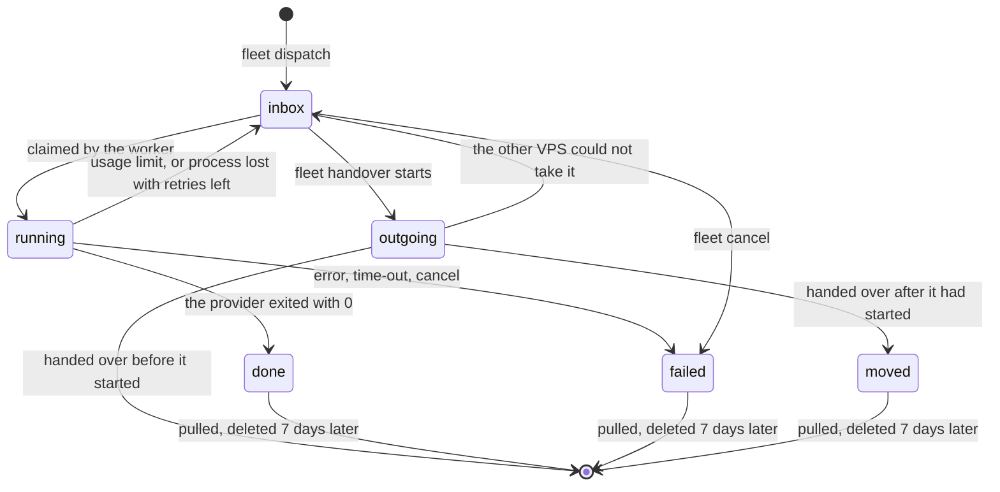

# Worker reference

`fleet-worker` is the job runner on every VPS: a bash program that runs as the systemd
service `fleet-worker`, under the unprivileged `fleet` user. The code is in
[`vps/worker/fleet-worker`](https://github.com/CoffeeTimeGX/hermes-fleet/blob/main/vps/worker/fleet-worker).
Your PC never runs a session itself; it only talks to this worker over SSH.

## Files on a VPS

```
/home/fleet/fleet/                  the fleet's folder on the VPS
  app/                              code copied from the repository's vps/ folder
  app.old/                          the code before the last fleet sync
  jobs/inbox/<id>.json              jobs waiting to start, oldest first
  jobs/outgoing/<id>.json           jobs that fleet handover is moving to another VPS
  jobs/running/<id>.json            jobs running now
  jobs/done/<id>.json               jobs that finished well
  jobs/failed/<id>.json             jobs that failed, timed out or were cancelled
  jobs/moved/<id>.json              jobs handed over after they had started here
  work/<id>/                        each job's workspace (below)
  logs/worker.log                   what the worker did, rotated weekly
  .paused                           present while the VPS is paused, with the reason
  .limit                            present while a usage limit holds the queue
  .heartbeat                        the time of the worker's last round
/etc/fleet/worker.env               the worker's settings, written by the bootstrap
/etc/fleet/worker.local.env         your own settings, if any (they win)
/etc/fleet/locked-down              present once public SSH is closed
/home/fleet/.config/fleet/providers/claude.env    the Claude credential (mode 600)
```

A job's workspace, `work/<id>/`:

| Path | What it is |
| --- | --- |
| `job.json` | The job as it was queued. |
| `status.json` | The worker's record: state, times, attempts, exit code, reason. |
| `output/` | The deliverables and `SUMMARY.txt`. |
| `logs/` | `provider.log`, `transcript.jsonl`, `claude.stderr`, and `limit.json` after a usage limit. |
| `result.json` | Claude Code's final result. |
| `.prepared` | The template and files are in place; they are not copied again on a retry. |
| `.pulled` | Your PC has the job, since the time inside. |
| `.claude-session`, `.resume-session` | The Claude session id, and the one to resume after a usage limit. |

## A job's life on the VPS



Every 5 seconds the worker:

1. writes its heartbeat,
2. checks whether it may start jobs: not while the VPS is paused, has less than 3 GB
   free, or waits for a usage limit,
3. claims the oldest job in the inbox while fewer jobs run than `MAX_PARALLEL`, and
   starts it in a process session of its own, under a time limit.

At start, and about every 5 minutes, it looks for running jobs whose process is gone,
after a reboot or a crash. Such a job goes back to the inbox while it has retries left
(`max_retries`, 1 by default), and is filed as failed otherwise.

The worker can restart (after `fleet sync`, for example) without touching the running
jobs, because each one runs in its own session. The restarted worker finds them again.

A handover (`fleet handover`) moves a waiting job to `jobs/outgoing/`, where it cannot
start, while your PC queues it on the other VPS. Then the job leaves this VPS: its file
is deleted, or, when it had already started here, it is filed as `moved` with its
workspace, so that the next pull brings home what it made. When the other VPS cannot
take it, the job goes back to the inbox in its old place.

## Exit codes and reasons

The provider's exit code decides what happens to the job:

| Exit code | State | Reason shown |
| --- | --- | --- |
| `0` | done | |
| `75` | back in the inbox | `usage limit: ... continues after ...` |
| `78` | failed | `provider claude has no credentials on vps1` |
| `124`, or `137` at the time limit | failed | `timed out after 180m` |
| `137` before the time limit | failed | `killed (often out of memory; see fleet status)` |
| `127` | failed | `provider claude not available on vps1`, or `provider exited 127` when Claude Code is missing |
| `65` | failed | `bad job: ...` (missing template, unsafe path, bad base64) |
| `130` | failed | `cancelled` or `cancelled before it started` |
| anything else | failed | `provider exited N` |

[Job failures](../runbooks/job-failures.md) explains what to do about each one.

## Commands

The `fleet` command on your PC runs these for you. To run one yourself, use `fleet exec`:

```
fleet exec vps1 -- fleet-worker status
```

| Command | What it does |
| --- | --- |
| `fleet-worker status [--json]` | The VPS's summary; `fleet status` shows it. |
| `fleet-worker jobs [--json] [--state S]` | The jobs on this VPS. |
| `fleet-worker logs ID [-f] [-n LINES]` | A job's provider log. |
| `fleet-worker cancel ID` | Cancel a waiting, outgoing or running job. |
| `fleet-worker release ID NODE`, `released ID`, `unrelease ID` | The three steps of a handover: take a waiting job out of the queue for NODE, let it go once NODE has it, or put it back. `fleet handover` runs them. |
| `fleet-worker finished [--json]` | Finished jobs that are not pulled yet. |
| `fleet-worker mark-pulled ID` | Mark a job as pulled. |
| `fleet-worker pause [REASON]`, `resume` | Stop and restart starting new jobs; `resume` also ends a usage-limit wait. |
| `fleet-worker gc [--days N]` | Delete the workspaces pulled more than N days ago (7 by default). |
| `fleet-worker recover` | Look for jobs whose process is gone, as the worker does every 5 minutes. |
| `fleet-worker version` | The worker's version. |
| `fleet-worker loop` | Run the worker (the service does this). |

Do not move or edit files in `jobs/` by hand while the worker runs; use these commands.

## Settings

The bootstrap writes `/etc/fleet/worker.env`. Change a setting in
`/etc/fleet/worker.local.env`, which the bootstrap never touches and which wins over
`worker.env`, then restart the worker:

```
fleet exec vps1 --root -- "echo 'MIN_FREE_GB=5' >> /etc/fleet/worker.local.env"
fleet restart vps1
```

| Setting | Default | Meaning |
| --- | --- | --- |
| `MAX_PARALLEL` | `sessions` from your inventory | Jobs that run at the same time. Change `sessions` in your inventory and re-run `fleet bootstrap <vps> --skip-upgrade` rather than setting it here. |
| `DEFAULT_TIMEOUT_MINUTES` | `180` | Time limit of a job that sets no `timeout_minutes`. |
| `DEFAULT_MAX_RETRIES` | `1` | Retries after a lost process, for a job that sets no `max_retries`. |
| `MIN_FREE_GB` | `3` | Below this much free disk, no new job starts. |
| `GC_DAYS` | `7` | The nightly cleanup deletes workspaces pulled more than this many days ago. |
| `LIMIT_MARGIN_SECONDS` | `60` | How long after a usage limit's reset the queue starts again. |
| `MAX_LIMIT_WAITS` | `50` | After this many usage-limit waits, a job is filed as failed. |
| `POLL_SECONDS` | `5` | How often the worker looks at its queue. |
| `FLEET_NODE`, `FLEET_ROOT` | the VPS's name, `/home/fleet/fleet` | Set by the bootstrap; leave them. |

## The status the worker reports

`fleet status --json` returns, per VPS, what `fleet-worker status --json` prints. The
fields other tools may use:

| Field | Meaning |
| --- | --- |
| `worker_version`, `service` | The worker's version, and the systemd state of its service. |
| `heartbeat_age_s` | Seconds since the worker's last round (`-1` before the first). |
| `max_parallel`, `paused`, `paused_reason`, `on_hold` | Capacity, and why no new job starts, if none does. |
| `limit` | The usage-limit wait, while it lasts: `provider`, `kind`, `message`, `until` (Unix time) and `until_iso`. |
| `queue` | `inbox`, `running`, `done`, `failed` and `unpulled` counts. |
| `stuck_handovers` | Jobs left in `jobs/outgoing/` for more than 10 minutes: a handover that stopped halfway. |
| `disk_free_gb`, `disk_free_pct`, `low_disk` | Free space, and whether it is under `MIN_FREE_GB`. |
| `load1`, `cpus`, `mem_available_mb`, `mem_total_mb`, `uptime_s` | The machine's load and memory. |
| `reboot_required` | Security updates wait for a reboot. |
| `providers` | One entry per provider: `installed`, `ok`, `version`, `auth` (`oauth-token` or `api-key`), `credential_age_days`, `error`. |

## Services and timers

| Unit | What it does |
| --- | --- |
| `fleet-worker.service` | Runs `fleet-worker loop` as `fleet`, and restarts it if it stops. Stopping the service leaves running jobs alone. |
| `fleet-gc.timer` | Runs the cleanup every day at 04:30 VPS time, plus up to 30 minutes. If the VPS was off then, it runs at the next start. |
| logrotate | Rotates `logs/worker.log` weekly and keeps 8 weeks. |

The `fleet` user may start, stop, restart and query its own service with `sudo`, and
nothing else as root.

## Providers

The worker does not know Claude. For each job it runs
`app/providers/<provider>/run.sh <job.json> <workspace>`, and the exit code tells it what
happened. That contract is what lets another tool join the fleet later. It is described
in [`vps/providers/README.md`](https://github.com/CoffeeTimeGX/hermes-fleet/blob/main/vps/providers/README.md),
and the steps are in [Add another provider](../providers/adding-a-provider.md).
